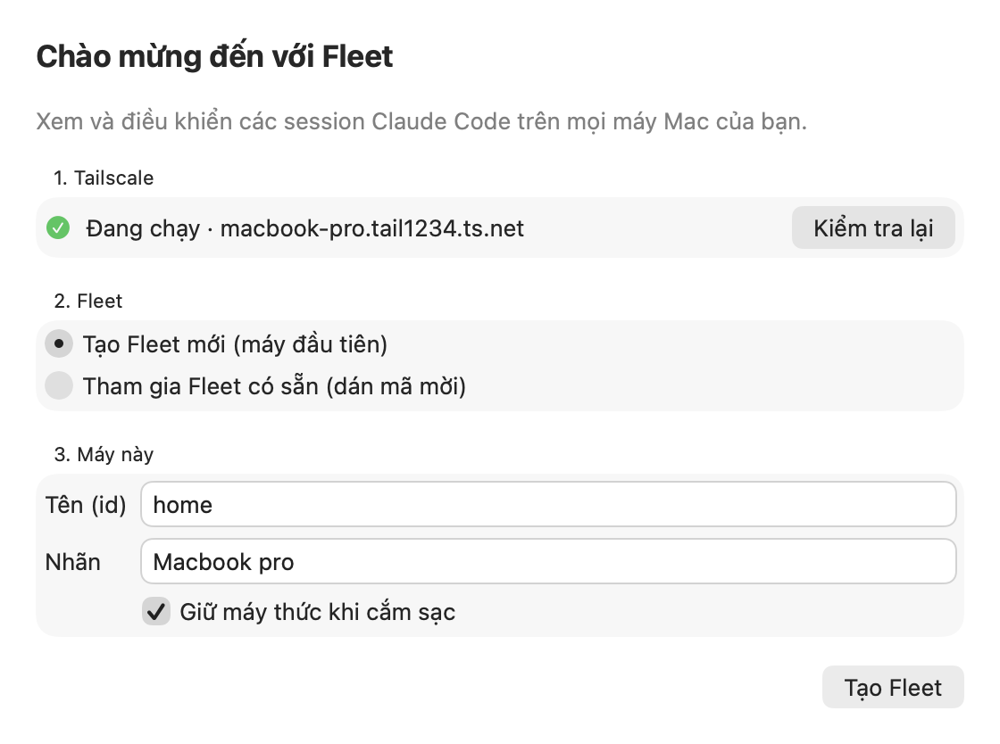
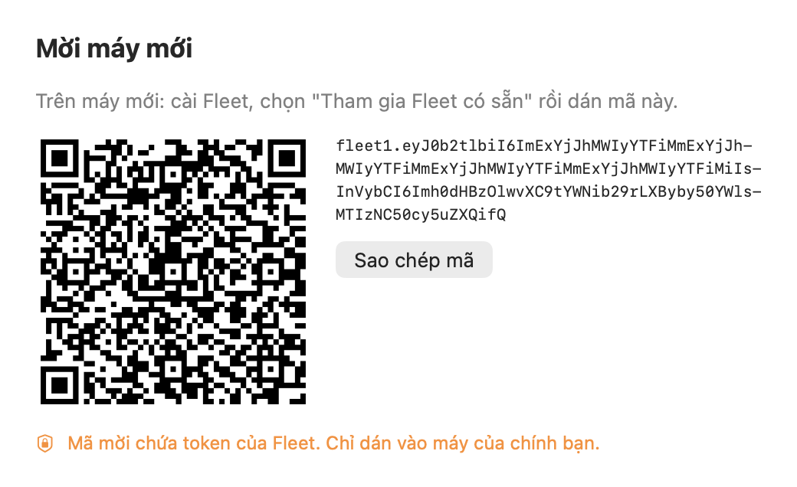
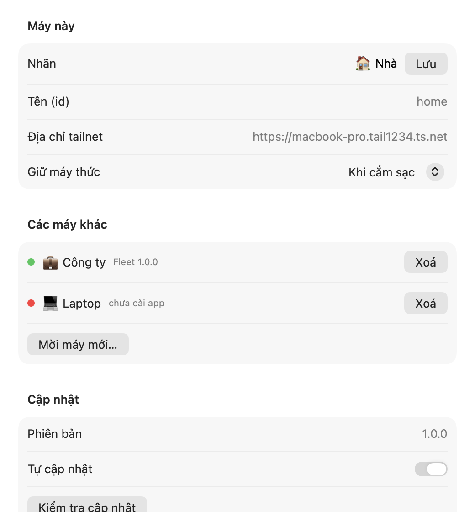

# Fleet

**See and steer your Claude Code sessions across every Mac you own — from the menu bar, a dashboard, or your phone.**

Fleet is a small macOS app for people who run [Claude Code](https://claude.com/claude-code) on more than one machine: a Mac at home that keeps working while you are away, a laptop you carry, maybe a third one in the office. It gathers every session from every machine into one place, tells you when one needs your answer, and lets you reply, start new work, or move a conversation to another Mac — over your private [Tailscale](https://tailscale.com) network, with nothing exposed to the internet.

<p align="center">
  
  
  
</p>

> The app's interface is currently in Vietnamese; this documentation is in English.

---

## Contents
- [Features](#features)
- [How it works](#how-it-works)
- [Requirements](#requirements)
- [Installation](#installation)
- [Using Fleet](#using-fleet)
- [Updates](#updates)
- [Security](#security)
- [Files and configuration](#files-and-configuration)
- [Uninstalling](#uninstalling)
- [Development](#development)
- [HTTP API](#http-api)
- [Limitations](#limitations)

## Features

**One view of everything**
- Every Claude Code session on every Mac, grouped by what it needs from you: *needs input → working → failed → done → idle*.
- A menu bar icon that shows how many sessions are waiting for you, on any machine; click one to jump straight to it.
- Native macOS notifications when a session needs input, finishes, or fails.
- The full conversation of any session (prompts, replies, tool calls) and the live terminal of background sessions.
- Works from an iPhone too: the same dashboard is served over HTTPS inside your tailnet.

**Control from anywhere**
- Start a new background session on any Mac, in any trusted project folder.
- Reply to a session: Fleet resumes it with your message under the same session id, wherever it runs.
- Stop, restart, or remove sessions.

**Built for several machines**
- Pair a new Mac with an invite code (or QR code); machines then learn about each other automatically.
- Keep a Mac awake while it is plugged in, so its sessions stay reachable — set per machine, from any machine.
- Move a conversation from one Mac to another (experimental).
- Signed self-updates, and a **Cập nhật tất cả máy** (*Update all machines*) button.

## How it works

```
        ┌──────────────── your tailnet (Tailscale, HTTPS) ────────────────┐
        │                                                                 │
  ┌─────┴──────────┐            ┌────────────────┐            ┌───────────┴────┐
  │  Mac (home)    │◄──────────►│  Mac (office)  │◄──────────►│  iPhone        │
  │  Fleet.app     │            │  Fleet.app     │            │  browser       │
  │   └ fleetd ────┼── reads ──►│   └ fleetd     │            │  (dashboard)   │
  │     Claude Code│            │     Claude Code│            └────────────────┘
  └────────────────┘            └────────────────┘
```

- **Fleet.app** is a native menu bar app (Swift). It ships with its own Python runtime and runs **fleetd**, a small service that reads Claude Code's local state — `claude agents --json`, `~/.claude/jobs/*/state.json` and the transcripts in `~/.claude/projects/` — and drives the `claude` CLI.
- fleetd listens on `127.0.0.1` only. `tailscale serve` publishes it to your tailnet over HTTPS; no port is opened on your LAN or the internet.
- Each fleetd asks the others for their snapshot and merges them, so the dashboard on any machine shows the whole fleet. If a machine is offline, its last known state is shown with a "last seen" time.

## Requirements

- macOS 14 (Sonoma) or later on Apple silicon.
- [Claude Code](https://claude.com/claude-code) installed and signed in on each Mac.
- [Tailscale](https://tailscale.com/download), signed in to the same tailnet on each Mac (and on your phone, if you want the dashboard there). **Tailscale Serve** must be enabled for the tailnet; Fleet shows the link to enable it if it is not.

## Installation

Run this in Terminal on each Mac:

```bash
curl -fsSL https://github.com/thaiduc96/fleet/releases/latest/download/install.sh | bash
```

The installer downloads the latest release, verifies its SHA-256 checksum and code signature, installs `Fleet.app` into `/Applications` (or `~/Applications`), and opens it. It needs nothing beyond a stock macOS.

Alternatively, download `Fleet-x.y.z.zip` from the [Releases](https://github.com/thaiduc96/fleet/releases) page and move `Fleet.app` to Applications. Because the app is not notarized, macOS asks for confirmation the first time: right-click the app and choose **Open**.

### First Mac
Fleet opens a short setup:
1. It checks that Tailscale is running.
2. Choose **Tạo Fleet mới** (*Create a new fleet*).
3. Give the machine an id (e.g. `home`) and a label (e.g. `🏠 Home`).
4. Fleet enables `tailscale serve` and starts.

### Every other Mac
1. On a Mac that already runs Fleet: menu bar icon → **Mời máy mới…** (*Invite a new Mac*), then copy the code or scan the QR code.
2. On the new Mac: install Fleet, choose **Tham gia Fleet có sẵn** (*Join an existing fleet*), and paste the code.

The new machine introduces itself and learns about every other machine; the rest of the fleet learns about it within seconds.

### Your phone
Install Tailscale on the phone, open `https://<your-mac>.<tailnet>.ts.net`, and sign in once with the fleet token. In Safari, *Share → Add to Home Screen* gives you an app-like icon.

### Coming from the script install
Earlier versions were installed with `install.sh` and `bin/fleet`. Just run the installer above: Fleet.app reuses `~/.fleet`, the token in the Keychain, your machines and keep-awake settings, and `tailscale serve`. It replaces the old `com.fleet.fleetd` LaunchAgent only after its own fleetd is confirmed running, and restores it otherwise.

## Using Fleet

### Menu bar
The icon shows the number of sessions waiting for you. The menu lists sessions that need input or are working (click one to open it), and gives access to the dashboard, invitations, settings, and updates.

### Dashboard
- **Sessions** are grouped by state and labelled with their machine. Enable **Lịch sử** (*History*) to also see sessions closed in the last three days.
- **Session details** show the conversation and, for background sessions, the terminal. Buttons copy the `claude attach` and `claude --resume` commands.
- **＋ Session** starts `claude --bg` on the chosen machine. The folder must be inside your home directory and trusted by Claude Code. Remote sessions may use the `manual`, `auto`, `acceptEdits` or `plan` permission modes; modes that skip permission prompts are deliberately not offered.
- **Replying** to a session continues the same session:

  | Session state | What Fleet does |
  |---|---|
  | Closed or stopped | `claude --bg --resume <id>` with your message |
  | Running in the background, between turns | stops it, waits for the process to exit, then resumes |
  | In the middle of a turn | refuses, unless you choose to interrupt it |
  | Open in a terminal | refuses — answer it there, or through Remote Control |

### Keeping a Mac awake
Claude Code keeps a Mac awake for only a few minutes while it is actively working. A session that is waiting for your answer lets the machine sleep, and then nothing can reach it. Each machine card on the dashboard has a **Giữ thức** (*Keep awake*) setting:

| Mode | Effect |
|---|---|
| Off | Normal sleep |
| While charging | `caffeinate -s`: no effect on battery (recommended for a desktop-like Mac) |
| Always | `caffeinate -i -s`: also on battery |

The card also lists which processes are currently keeping the machine awake. Closing a MacBook's lid still puts it to sleep unless an external display is connected.

### Moving a session to another Mac *(experimental)*
In a session's details, choose **Chuyển sang <machine>** (*Move to …*). Fleet checks both machines first and warns about uncommitted changes, missing commits, a different branch or remote, an untrusted folder, or an existing copy. It then copies the conversation (transcript, sub-agent logs, file history), rewrites home-directory paths for the target machine, and optionally resumes the session there with a message.

Code is **not** moved: the repository must exist at the same path relative to `~` on the target, with your commits pushed and pulled. The copy on the source machine is kept as a backup.

## Updates

Fleet checks GitHub Releases every six hours (this can be turned off in Settings), and you can trigger a check from the menu or update every machine at once from the dashboard.

An update is installed only if:
1. the archive carries a valid **Ed25519 signature** made with the release key, whose public half is built into the app;
2. its SHA-256 matches the published `checksums.txt`;
3. the unpacked app passes `codesign --verify` and has the expected version and bundle identifier.

The app is then swapped in atomically, the previous version is kept until the next launch, and Fleet relaunches itself.

## Security

- **Network:** fleetd binds to `127.0.0.1`. Other devices reach it only through `tailscale serve` (HTTPS inside your tailnet).
- **Authentication:** every API call needs the fleet token (bearer header or an `HttpOnly`, `SameSite=Strict` cookie). Write calls also need an `X-Fleet-Request` header, which blocks cross-site requests.
- **Token storage:** the token lives in the login Keychain. The app passes it to `security` on stdin, never on a command line, and keeps the dashboard's cookie in memory only.
- **Peers:** machines learned through invitations or from other machines must be `https://<name>.ts.net` addresses in your own tailnet; IP addresses, plain HTTP and other hosts are refused, so the token is never sent elsewhere.
- **Invite codes contain the token.** Only paste them on your own machines.
- **Remote session control** is limited to folders inside your home directory and to permission modes that still ask before risky actions.
- **Updates** are signed with a key that never leaves the maintainer's machine (see [Updates](#updates)).

## Files and configuration

| Location | Purpose |
|---|---|
| `/Applications/Fleet.app` | The app, including its Python runtime and fleetd |
| `~/.fleet/config.toml` | Machine id, label, port |
| `~/.fleet/state.json` | Settings changed at runtime: known machines, keep-awake mode, label, own URL |
| `~/.fleet/cache/` | Last known snapshot of each other machine |
| `~/.fleet/fleetd.log` | fleetd log |
| Keychain item `fleet.token` | The shared fleet token |
| `~/Library/LaunchAgents/com.fleet.app.plist` | Starts Fleet at login, and restarts it if it crashes |

## Uninstalling

```bash
osascript -e 'tell application id "com.fleet.app" to quit'
launchctl bootout gui/$(id -u)/com.fleet.app 2>/dev/null
rm -f ~/Library/LaunchAgents/com.fleet.app.plist
rm -rf /Applications/Fleet.app ~/.fleet
security delete-generic-password -s fleet.token -a fleet
tailscale serve --https=443 off
```

## Development

```
app/              Swift package: the Fleet menu bar app (Fleet) and pure logic with tests (FleetCore)
fleetd/           Python backend (FastAPI): sessions, control, peers, keep-awake, handoff
fleetd/web/       Dashboard: src/app.ts (strict TypeScript) compiled to app.js, which is committed
tests/            pytest suite
scripts/          test, build, release and install scripts
```

```bash
scripts/test.sh                 # pytest, ruff, tsc --noEmit, swift test
scripts/build-app.sh 1.2.3-dev  # dist/Fleet.app + dist/Fleet-1.2.3-dev.zip
npm run build                   # recompile the dashboard after editing fleetd/web/src/app.ts
```

- `Fleet --render-previews <dir>` renders the app's windows to PNG files (used for the screenshots above).
- `FLEET_DEV=1` runs a development build next to an installed Fleet without touching LaunchAgents, notifications or updates; combine it with `FLEET_HOME=<dir>` and a different `port` in that directory's `config.toml`.
- Everything that depends on Claude Code internals is isolated in `fleetd/claude_cli.py`, `fleetd/transcripts.py` and `fleetd/handoff.py`.

### Releasing
1. Bump `VERSION` and merge to `main`.
2. Run `scripts/release.sh` on the machine that holds the release key (`~/.fleet/release-signing-key`). It runs every check, builds, signs, tags and publishes the release — archive, signature, `checksums.txt` and `install.sh` — in one step, so an unsigned release is never visible to the apps.

## HTTP API

All endpoints require the fleet token, except `/api/hello` and the dashboard itself. Write endpoints also require `X-Fleet-Request: 1`. Every `/api/m/<machine>/…` route performs the same operation on another machine through this one.

| Method & path | Description |
|---|---|
| `GET /api/hello` | Identity of this fleetd (no secrets) |
| `GET /api/fleet` | Snapshot of every machine |
| `GET /api/local` · `GET /api/health` | This machine's snapshot · health and keep-awake state |
| `GET /api/sessions/<id>/transcript` · `/logs` | Conversation · terminal output |
| `POST /api/sessions` | Start a background session |
| `POST /api/sessions/<id>/message` · `/stop` · `/respawn` · `DELETE /api/sessions/<id>` | Reply · stop · restart · remove |
| `POST /api/awake` | Keep-awake mode: `off`, `ac`, `always` |
| `POST /api/handoff` | Move a session between machines (`dryRun` to preview) |
| `POST /api/peers/join` · `DELETE /api/peers/<machine>[?everywhere=true]` | Pair a machine · remove one |
| `POST /api/settings` · `POST /api/update` | Label and own URL · ask Fleet.app to update |

## Limitations

- Apple silicon Macs only, macOS 14 or later.
- Fleet reads files that are internal to Claude Code. A Claude Code update can change them; the affected code is isolated so it can be fixed quickly.
- Moving sessions between Macs is experimental and does not move code.
- Releases are not notarized by Apple, so a manually downloaded archive needs *right-click → Open* the first time; the installer and the built-in updater are not affected.
